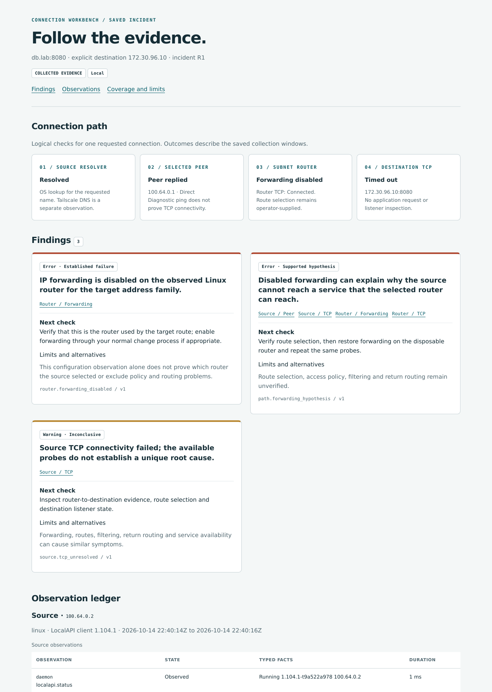

# A peer ping works. The service connection does not.

This three-minute demo investigates one routed connection using evidence collected on its source and Linux subnet router. It shows the additional conclusion supported by the router bundle, and what the tool refuses to conclude without it.

The evidence was collected from real Tailscale v1.104.1 daemons, Headscale 0.29.5 and a disposable TCP service in isolated containers on one Mac. These are saved observations from a controlled lab, not a live customer incident or a Tailscale-service deployment.



The preview is an offline-rendered crop. The downloadable HTML contains the complete report and evidence links. Browser interaction and accessibility checks remain unverified.

## 1. Compare the same connection before, during and after the fault

| Evidence | Healthy | Forwarding disabled | Restored |
| --- | --- | --- | --- |
| Source OS resolves the lab name | Yes | Yes | Yes |
| Selected router replies to peer ping | Yes | Yes | Yes |
| Source connects to destination TCP | Connected | Timed out | Connected |
| Router connects directly to destination TCP | Connected | Connected | Connected |
| Router IPv4 forwarding | Enabled | Disabled | Enabled |

Artifacts: [healthy](examples/lab-run/H1/incident.json), [fault](examples/lab-run/R1/incident.json), [recovery](examples/lab-run/R1-recovered/incident.json).

The lab name comes from `/etc/hosts`. The Tailscale QueryDNS probe fails in all three runs because that endpoint does not resolve the hosts entry. The healthy label describes the tested connection, not a blanket assertion that all diagnostics passed or that MagicDNS was tested.

## 2. Remove the router evidence

With only the source bundle, the analyzer reports an inconclusive TCP failure. It does not guess that forwarding, access policy or the service is responsible.

Adding the matching router bundle establishes that forwarding is disabled and that the router itself can reach the service. The analyzer then emits a conditional explanation: disabled forwarding can explain the source failure if this is the router actually used by the route. Route selection, filtering and return routing remain unverified.

The useful next check is to verify route selection and repeat after restoring forwarding. The recorded recovery is a separate run in which the source connection works again. The report itself does not automatically compare runs or claim to prove causation.

## 3. Replay it locally

Requires Go 1.27.1 and Python 3. No Docker, second computer or Tailscale login is needed. Building may download Go dependencies; replaying the saved bundles makes no network probes.

```sh
make demo
```

Open the numbered HTML files in the printed output directory:

1. Healthy control.
2. Fault with source evidence only.
3. The same fault with source and router evidence.
4. Recorded recovery.
5. Pseudonymized paired report.

The replay verifies that the forwarding hypothesis appears only with the router evidence and survives export. Follow a finding's evidence links to inspect the underlying observations. The CLI also supports missing-router evidence in normal use.

To collect new evidence in the disposable local topology, see `make lab` in the [README](README.md). That is a separate operation requiring Docker and scoped network capabilities.

## What this could help with

An operator or support engineer investigating a specific subnet-routed service can collect bounded bundles on two machines and share one offline report. It combines checks that otherwise have to be requested and compared manually. No reduction in support resolution time has been measured.

This is a prototype for feedback on that workflow. It does not evaluate access policy, discover the selected route, inspect the destination listener, establish application health or fix configuration automatically. Collection on two machines and choosing the correct router remain manual. Separate-host/network, native macOS daemon, IPv6 and Tailscale-service validation are still pending.

## Feedback sought

Would paired source/router evidence be useful for subnet-router troubleshooting? Which additional observation would make this incident actionable for an operator or support engineer? Would an extension to an existing diagnostic tool be a better home?

See [verification and limitations](docs/VALIDATION.md), [the review assessment](docs/REVIEW.md), and [overlap with existing tools](docs/OVERLAP.md).
