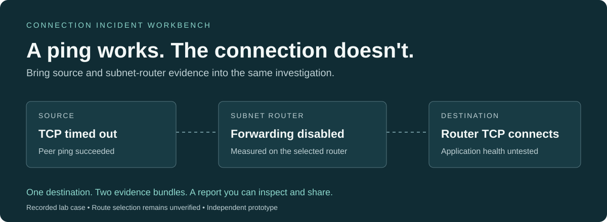

# Connection Incident Workbench

**Investigate one failed connection using evidence from both sides of a subnet router.**

[](https://balkashynov.github.io/connection-incident-workbench/)

[**Open the browser demo →**](https://balkashynov.github.io/connection-incident-workbench/) · [Three-minute walkthrough](DEMO.md) · [Validation](docs/VALIDATION.md) · [Evidence contract](docs/EVIDENCE.md)

A diagnostic peer ping can succeed while a service connection fails. This Go CLI collects bounded observations on the source and a selected Linux subnet router, combines them into an offline incident report, and links each finding to its evidence.

Built for an operator or support engineer investigating **one explicit destination**. Independent prototype for feedback; no Tailscale affiliation or adoption claimed.

## See what the second machine changes

| Evidence | Source only | Add the router | After restoring forwarding |
| --- | --- | --- | --- |
| Source can ping the selected peer | Yes | Yes | Yes |
| Source TCP reaches the service | Timed out | Timed out | Connected |
| Router forwarding | Unknown | Disabled | Enabled |
| Router TCP reaches the service | Unknown | Connected | Connected |
| Supported conclusion | Failure remains unexplained | Disabled forwarding can explain the failure **if this is the selected route** | A separate run records successful connectivity |

The [browser demo](https://balkashynov.github.io/connection-incident-workbench/#source-only) lets you compare all three, inspect the complete reports, and view the pseudonymized export. It displays saved observations from real Tailscale daemons in a controlled, single-host lab. It does not execute network probes in your browser.

## Try it

Requires **Go 1.27.1** and **Python 3**. Building may download dependencies; replaying the saved evidence needs no Docker, Tailscale login, or second machine.

```sh
git clone https://github.com/balkashynov/connection-incident-workbench.git
cd connection-incident-workbench
make demo
```

Open the numbered HTML reports in the printed directory: healthy control, source only, paired evidence, recorded recovery, and shareable export. The replay checks that the forwarding hypothesis requires router evidence and survives export.

## How it works

1. **Collect:** OS DNS, selected peer ping and explicit-IP TCP on the source; forwarding and direct TCP on the Linux router. Use the same incident and destination on both machines.
2. **Correlate:** validate destination, router identity, provenance and collection windows. Separate observed facts, supported hypotheses and unknowns.
3. **Share:** pseudonymize identifiers consistently, recompute findings and render a standalone HTML report. No scripts, external assets or upload destination in the report.

### Where this fits

Use Tailscale's own diagnostics for daemon/network checks, [Taildoctor](https://github.com/jjhfarmer/taildoctor) for local readiness checks, or [TailTunnel](https://github.com/rajsinghtech/tailtunnel) for its monitoring and browser SSH workflow. This prototype explores **destination-specific source/router correlation** and portable evidence. It could become an extension to existing tooling if that is the better home. [Dated source comparison and limits](docs/OVERLAP.md).

## Collect a new incident

Requires Go 1.27.1 (the pinned `tailscale.com v1.104.1` dependency requires it).

```sh
make build
bin/connection-workbench collect --role source --incident example-1 \
  --target db.internal:5432 --address 192.0.2.10 --router 100.64.0.2 \
  --out source.json
# Run separately on the explicitly selected Linux subnet router:
bin/connection-workbench collect --role router --incident example-1 \
  --target db.internal:5432 --address 192.0.2.10 --out router.json
bin/connection-workbench analyze --source source.json --router router.json --out incident.json
bin/connection-workbench report --input incident.json --out incident.html
bin/connection-workbench export --input incident.json --out shared.json
bin/connection-workbench report --input shared.json --out shared.html
```

The addresses above are examples. Supply the same incident ID, name, explicit destination IP and port on both machines. `--router` is the selected router's Tailscale IP, checked against the router bundle's observed identity. The prototype does not discover the selected route. Collect close together; wall-clock gaps over 30 seconds disable cross-machine hypotheses. No causal ordering is inferred even when windows overlap.

Open the HTML directly in a browser. It has no scripts, remote assets or upload destination. Output files are created exclusively with mode 0600; use a new filename to repeat a command. Missing router evidence is supported: omit `--router` from `analyze`.

Collection makes a bounded name lookup, diagnostic peer ping and one TCP connection to the explicit endpoint. It makes no configuration changes or application request. Each network probe has a separate deadline (`--timeout`, default 2s, maximum 30s). The forwarding fact is read from Linux procfs for the target address family. LocalAPI failures do not suppress independent OS probes. Use `--socket` only to select a local daemon socket.

## Reproduce the lab

```sh
make test
make lab
```

Needs Docker with Linux containers and `/dev/net/tun`, Python 3 and OpenSSL. The lab builds the upstream DERP relay, uses pinned release images and creates internal Docker networks with no published ports. Only the disposable source/router containers receive `NET_ADMIN`. The service is on a network the source cannot directly join. Headscale registration keys remain in memory; lab state volumes are removed on exit. No ordinary tailnet login is required.

The experiment records healthy, forwarding-disabled, DNS-failure, TCP-refusal and restored runs, plus a missing-router control and actual unprivileged LocalAPI observations. Each main case writes source/router JSON, analyzed JSON, standalone HTML and pseudonymized exports under `lab/results/<run>/`. A successful run produces `verification.json`. An interrupted or failed run is not a passing result.

Forwarding faults recreate the **lab router** with a different container-scoped sysctl, retaining its disposable node identity. DNS faults change only the source container's hosts entry; this tests a resolver discrepancy, not Tailscale DNS internals. Service faults close only the test listener while keeping its container running. Cleanup targets this run's Compose project, never global Docker resources.

## Evidence and limits

- [Evidence contract](docs/EVIDENCE.md): versioning, validation, interpretation and export boundaries.
- [Overlap comparison](docs/OVERLAP.md): exact Taildoctor/TailTunnel revisions and why a companion prototype is useful.
- [Validation record](docs/VALIDATION.md): actual executed scenarios and remaining limits.

The prototype does not evaluate ACLs, discover approved routes, inspect destination listeners, prove application health or automatically remediate problems. QueryDNS may fail or be denied while OS resolution succeeds. A TCP refusal does not prove no listener exists. A TCP timeout does not establish a firewall or ACL cause.

Pseudonymization uses one map across all bundles, removes raw identifiers and recomputes findings. It retains topology, ports, timing and platform. Review the export before sharing. No auth keys, login URLs, raw preferences, packet data, usernames or full peer inventories are collected. Input is bounded to 2 MiB / 32 observations per bundle; unknown fields and unsupported schema versions are rejected. Bundles are not cryptographically authenticated.

## Review status

This is a narrow prototype for engineering feedback. See [the engineering review](docs/REVIEW.md) and [current presentation verification](docs/PRESENTATION-REVIEW.md). The useful unit is a saved incident for one explicit destination, collected locally on the source and a selected Linux subnet router. No improvement in support resolution time or production adoption has been measured.

## License

MIT. Dependencies retain their own licenses. Tailscale is a dependency and the subject of the diagnostics; this project is independent.
